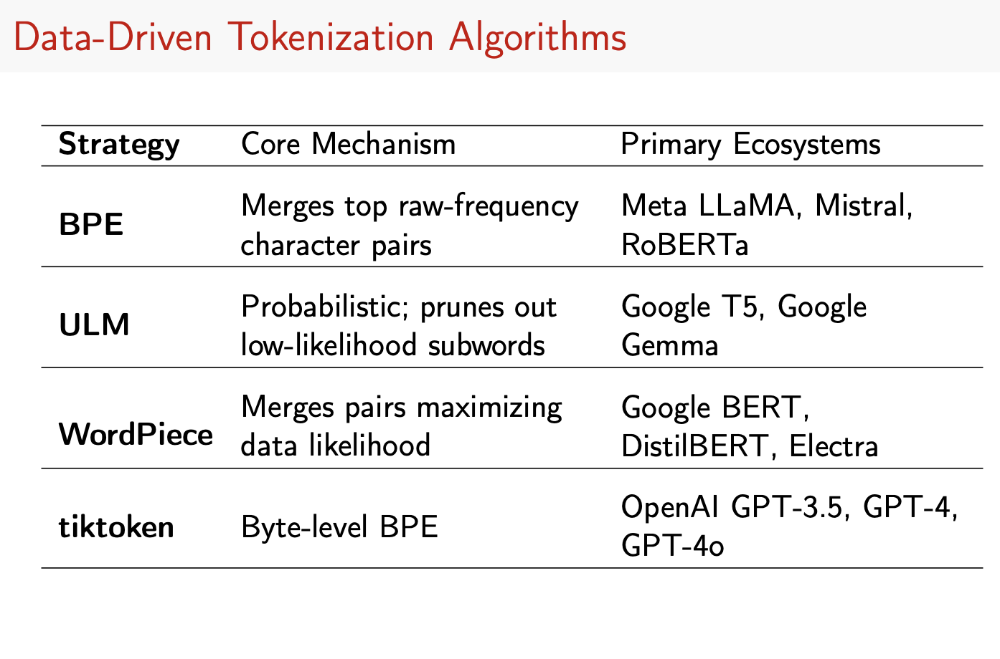
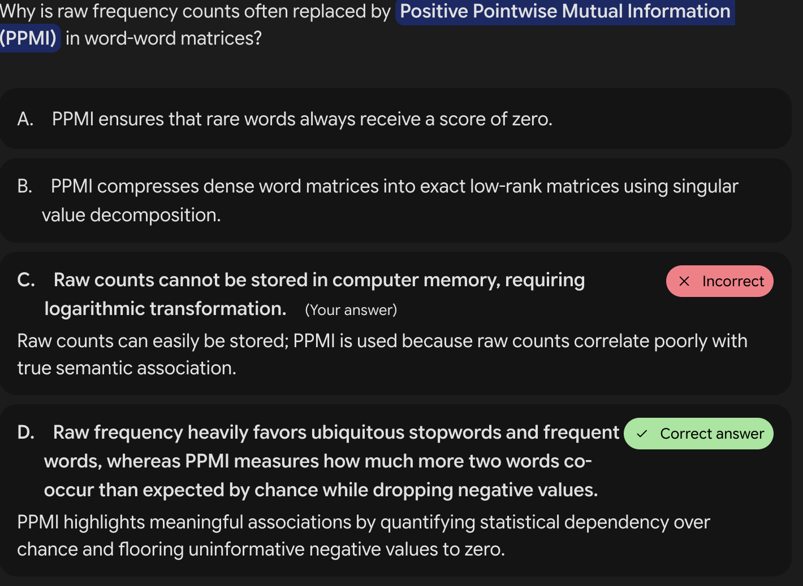
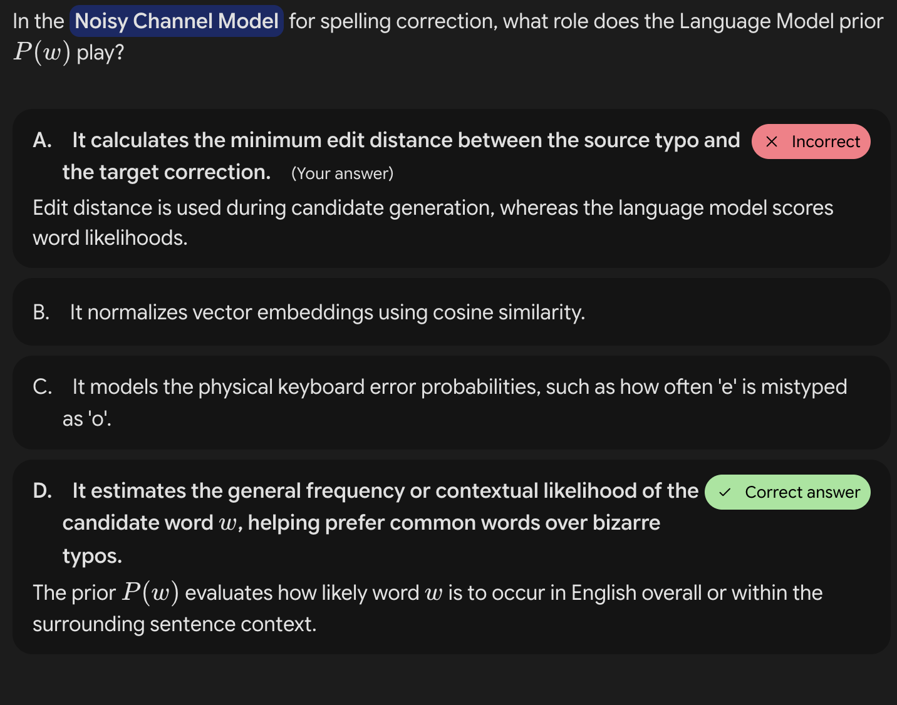

---

## 1. Words and Subwords

### Word Types and Instances
* **Corpus (pl. Corpora):** A text dataset used for linguistic analysis and model training[cite: 9].
* **Types vs. Tokens (Instances):**
  * **Type ($\vert{}V\vert{}$):** An element of the vocabulary, representing the set of *unique* words[cite: 9].
  * **Token / Instance ($N$):** An individual occurrence of a word type in running text[cite: 9].
* **Lemmas vs. Wordforms:**
  * **Lemma:** The base citation form sharing a stem, part of speech, and rough word sense (e.g., *cat* and *cats* share the same lemma)[cite: 7].
  * **Wordform:** The fully inflected surface form of a word[cite: 7].
* **Cross-Linguistic Challenges:** Orthographic boundaries (spaces) do not exist in all languages. For example, Chinese writes words using sequences of characters (*hanzi*), where a single sentence can be segmented in multiple valid ways (e.g., 3 words in Chinese Treebank vs. 5 words in Peking University standards)[cite: 8].

### Heaps' Law (or Herdan's Law)
* **Definition:** Describes how vocabulary size ($\vert{}V\vert{}$) grows relative to corpus size ($N$)[cite: 10]:
  $$\vert{}V\vert{} = k N^\beta$$
  where $0 < \beta < 1$ (typically around $0.5$) and $k$ is a constant[cite: 10].
* **Implications:** Function words (prepositions, articles) saturate early and do not grow indefinitely, whereas content words (nouns, verbs, adjectives) continue to grow as corpus size increases[cite: 10].

### Morphemes
* **Definition:** A morpheme is the minimal meaning-bearing unit in a language[cite: 13].
* **Components:** 
  * **Root:** The central morpheme providing the core meaning[cite: 13].
  * **Affixes:** Inflectional (syntactic role like tense/plural) or derivational (changing grammatical class)[cite: 13].
  * **Clitics:** Reduced forms attached to other words acting with independent grammatical meaning (e.g., *I've*, *teacher's*, *l'opéra*)[cite: 13].
* **Typological Classifications:** Languages vary widely in morphemes per word, ranging from analytic/isolating languages (like Vietnamese, averaging ~1.1) to agglutinative languages (like Turkish, with clean boundaries) and fusion languages (like Russian, where a single affix conflates multiple categories)[cite: 14].

---

## 2. Tokenization

### Rule-Based Word Tokenization
* **Unix-Based Tokenization:** Basic word frequency counts can be achieved efficiently using standard shell pipelines (`tr`, `sort`, `uniq`)[cite: 16, 17, 18].
* **Challenges in Tokenization:** Clitic contractions (*I'm*, *what're*), hyphenated compounds (*state-of-the-art*), punctuation, numbers, URLs, and hashtags[cite: 20].
* **Deterministic Regular Expressions:** Standard rule-based tokenizers (such as NLTK's `regexp_tokenize`) use finite-state automata and regular expressions to parse tokens quickly[cite: 21].

### Data-Driven Subword Tokenization
* Subword tokenization addresses unknown words and vocabulary explosion by segmenting text into subwords, morphemes, or characters[cite: 23]. It relies on a two-fold scheme: a **token learner** (induces vocabulary from a corpus) and a **token segmenter** (applies vocabulary to new text)[cite: 23].
* **Core Subword Algorithms:**
  * **Byte-Pair Encoding (BPE):** Iteratively merges the most frequent pairs of adjacent bytes or character $n$-grams[cite: 25, 32]. Used by GPT-2, LLaMA, Mistral, and RoBERTa[cite: 24, 35].
  * **WordPiece:** Merges pairs that maximize data likelihood; uses a `##` prefix for subwords (used by BERT, DistilBERT)[cite: 24, 35].
  * **Unigram Language Model:** Starts from a massive vocabulary and prunes low-likelihood subwords based on a loss function (used in SentencePiece / T5)[cite: 35].
  * **Multilingual Bottlenecks:** Standard multilingual BPE tokenizers are heavily biased toward English, causing "over-segmentation" (higher fertility and lower efficiency) in other languages[cite: 36].

### BPE (Byte-Pair Encoding) (https://en.wikipedia.org/wiki/Byte-pair_encoding)

1. Start with the individual characters of the corpus as the initial vocabulary.
2. Count the frequency of all adjacent pairs of symbols in the corpus.
3. Merge the most frequent pair into a new symbol and add it to the vocabulary.
4. Repeat steps 2-3 until the desired vocabulary size is reached or no more merges are possible.

Here is a clear, step-by-step breakdown of how **Byte-Pair Encoding (BPE)** evolves across these three models—from a traditional data compression tool into the backbone of modern Large Language Models (LLMs).

---

## 1. The Original BPE Algorithm (Data Compression)

* **The Main Goal:** **Compress text** to make it smaller in file size.
* **How it works:** It looks at a text sequence, finds the most frequently occurring pair of adjacent characters, and replaces every instance of that pair with a brand-new, unused placeholder symbol or byte.
* **The Process:**
1. Start with raw text (e.g., `aaabdaaabac`).
2. Find the most common pair (`aa`) and swap it with a placeholder (`Z`). You keep a lookup table (`Z = aa`).
3. Repeat for other frequent pairs (e.g., replacing `ab` with `Y`).

* **Decompression:** To get the original text back, you simply look at your lookup table and reverse the substitutions step-by-step.

---

## 2. The Modified BPE Algorithm (For Language Models)

* **The Main Goal:** **Tokenization**—turning text into a sequence of natural numbers (integers) that a neural network can process, *not* achieving maximum compression.
* **Key Differences from the Original:**
* Instead of using placeholder letters like "Z", it assigns every merged sequence a **token ID number**.
* It stops running when it hits a **prescribed vocabulary size** (for example, GPT-4 uses a vocabulary size of 100,258).

* **How it works:**
1. **Initialization:** Start with all unique base characters as single-character tokens (e.g., `a=0, b=1, d=2, c=3`).
2. **Merging:** Iteratively find the most frequent adjacent pair of tokens, merge them into a new longer subword token, and assign it the next available ID number (e.g., `aa=4`, `ab=5`).
3. **Stopping Rule:** Unlike the original algorithm which runs until no pairs repeat, the modified version stops strictly when it reaches its target vocabulary limit.

---

## 3. Byte-Level BPE (Handling Every Language & Symbol)

* **The Problem:** If a tokenizer's vocabulary is trained only on specific letters (like `a, b, c, d`), it will fail when it encounters foreign alphabets, special symbols, or emojis (like "no" or emojis), labeling them as unknown (`[UNK]`).
* **The Solution:** **Byte-Level BPE** converts all input text into **UTF-8 bytes** before running the BPE algorithm.
* **Why it matters:** Because UTF-8 can represent any character, symbol, or script in the world using fundamental byte values, byte-level BPE guarantees that *no text ever becomes unencodable*. This approach is used by models like GPT-2, GPT-4, RoBERTa, and BART.

---

## 3. Text Normalization

Word normalization is the task of putting words/tokens in a standard format E.g., Information Retrieval: we want to match U.S.A. and USA, indexed text and query terms must have same form

### Normalization Tasks
* **Case Folding:** Lowercasing text to match standard formats (e.g., matching *US* and *us*), highly useful for Information Retrieval and speech recognition[cite: 38].
* **Lemmatization:** Reducing inflected forms back to their base lemma using complete morphological parsing (e.g., *is*, *are*, *am* $\rightarrow$ *be*)[cite: 39].
* **Stemming:** A crude, rule-based chopping of affixes to reduce words to stems without full morphological analysis (e.g., the Porter Stemmer using cascading rewrite rules like `ING $\rightarrow \epsilon$` or `ATIONAL $\rightarrow$ ATE`)[cite: 40].
* **Sentence Segmentation:** Disambiguating sentence boundaries using punctuation cues (periods are ambiguous due to abbreviations like *Mr.* or *Inc.*)[cite: 41].

---

## 4. Regular Expressions (Regex)

* **Purpose:** Formal language for specifying text patterns, extracting information, performing substitutions, and driving tokenization/normalization pipelines[cite: 48].
* **Key Syntax Elements:**
  * **Disjunctions (`[...]`):** Matches any character inside brackets (e.g., `[mM]` matches 'm' or 'M')[cite: 50]. Ranges can be specified with a dash (`[a-z]`, `[0-9]`)[cite: 50].
  * **Negations (`[^...]`):** Caret as the first character inside brackets negates the set (e.g., `[^A-Z]` means not an uppercase letter)[cite: 51].
  * **Alternation (`|`):** Logical OR operator (e.g., `groundhog|woodchuck`)[cite: 52].
  * **Anchors:** `^` (start of line), `$` (end of line), `\b` (word boundary), `\B` (non-word boundary)[cite: 53].
  * **Quantifiers:** `*` (zero or more), `+` (one or more), `?` (zero or one), `{n}` (exact count)[cite: 54].
  * **Escape Character (`\`):** Used to match literal special characters like `\.`, `\*`, or `\[`[cite: 54].
  * **Capture Groups (`(...)`):** Used to isolate sub-patterns for extraction or substitution (referenced using `\1`, `\2`, etc.)[cite: 57]. Non-capturing groups are written as `(?:...)`[cite: 57].

---

## 5. Minimum Edit Distance

### Definition & Applications
* **Minimum Edit Distance:** The minimum number of editing operations (insertions, deletions, substitutions) required to transform one string into another.
* **Applications:** Spelling correction (e.g., *graffe* $\rightarrow$ *giraffe*), coreference resolution (Coreference resolution (CR) is an NLP task that aims to group expressions referring to the same real-world entity to acquire less ambiguous text. It can be very useful in such tasks as text understanding, information extraction, summarization, or question answering.), and evaluating Automatic Speech Recognition (ASR) via **Word Error Rate (WER)**[cite: 63]:
  $$\text{WER} = 100 \times \frac{\text{Insertions} + \text{Substitutions} + \text{Deletions}}{\text{Total Words in Correct Transcript}}$$
[cite: 63]

Word Error Rate (WER) is the standard metric used to measure the accuracy of automatic speech recognition (ASR) and speech-to-text systems. It compares a system's transcribed text against a verified reference transcript ("ground truth")

### Levenshtein Distance & Dynamic Programming
* **Levenshtein Distance:** Assigns a uniform cost of 1 to insertions, deletions, and substitutions (substituting a character for itself has a cost of 0).
* **Dynamic Programming Approach:** Finding the shortest path through an enormous search space of edits can be efficiently solved using a table-driven dynamic programming approach, reusing sub-problem solutions to avoid redundant computations.
* **Backtrace Alignment:** Cells in the dynamic programming table store pointers (arrows) indicating which neighboring cells they originated from, allowing a backtrace to reconstruct the optimal sequence of edit operations (alignment path).

---

## 6. Spelling Correction

### Types of Spelling Errors
1. **Non-Word Spelling Errors:** Typographical errors resulting in unindexed/invalid words (e.g., *graffe*). Detected via a dictionary lookup and ranked using distance metrics.
2. **Real-Word Spelling Errors:** Errors resulting in valid words due to typos (e.g., *there* instead of *three*) or cognitive slips (*dessert* vs. *desert*).

### The Noisy Channel Model
* Treats the observed misspelled word ($x$) as a distorted version of an intended original word ($w$) passed through a noisy channel.
* **Bayesian Inference Formulation:** We seek the word $\hat{w}$ in vocabulary $V$ that maximizes the posterior probability:
  $$\hat{w} = \arg\max_{w \in V} P(w\vert{}x) = \arg\max_{w \in V} P(x\vert{}w) P(w)$$
  where:
  * $P(x\vert{}w)$ is the **Channel Model** (Error Model): How likely is it that word $w$ turned into typo $x$?
  * $P(w)$ is the **Prior** (Language Model): How frequent or likely is word $w$ in general or given context $P(w\vert{}c)$?

### Damerau-Levenshtein Distance & Error Models
* Extends standard edit distance by including **transpositions** (swapping two adjacent letters) alongside insertions, deletions, and substitutions, capturing the vast majority of single-letter typing errors.
* **Confusion Matrices:** Error models estimate $P(x\vert{}w)$ using empirically derived confusion matrices (`del[]`, `ins[]`, `sub[]`, `trans[]`) tracking how often specific characters are mistyped.
* **Contextual Improvement:** While unigram priors evaluate words out of context, integrating a context-aware language model ($P(w_i \vert{} w_{i-1})$) resolves ambiguities where a standalone error model might misrank candidates.

